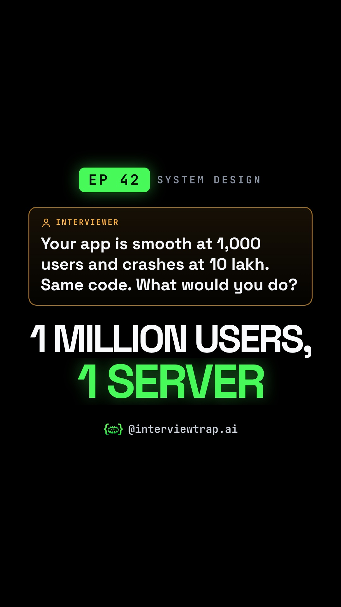

# EP 42 · Load Balancers Explained: Why Users Get Logged Out After You Add Servers (System Design Interview)

| | |
|---|---|
| Category | System Design & Scaling |
| Duration | 75.3 s |
| Video | [1-million-users-one-cashier-load-balancers-001.mp4](https://raw.githubusercontent.com/PunithVT/career-ops/main/interview-prep-videos/videos/1-million-users-one-cashier-load-balancers-001.mp4) |
| Cover / thumbnail | [1-million-users-one-cashier-load-balancers-001.jpg](https://raw.githubusercontent.com/PunithVT/career-ops/main/interview-prep-videos/covers/1-million-users-one-cashier-load-balancers-001.jpg) |
| Subtitles | [1-million-users-one-cashier-load-balancers-001.srt](https://raw.githubusercontent.com/PunithVT/career-ops/main/interview-prep-videos/subtitles/1-million-users-one-cashier-load-balancers-001.srt) |



## Instagram caption
```
EP 42 · Same code. Smooth at 1,000 users, dead at 10 lakh. Is a bigger server enough?

Scaling up is a fair first step, but one machine always has a ceiling, and if it goes down, your whole app goes down. A stronger answer puts a load balancer in front of many servers. Picture a helper at a pani puri lane who sends every customer to the shortest line (least connections). Then mention caching, database scaling and queues, because more app servers won't help if the database is the bottleneck. And turn on health checks so no request is sent to a dead server.

Users are randomly getting logged out. Why? One word 👇

Send this to a friend who has a system design interview coming up.
Follow @interviewtrap.ai for daily interview traps.

Animated emoji: Noto Emoji Animation by Google, CC BY 4.0 (creativecommons.org/licenses/by/4.0). Modified (resized/re-timed).

#SystemDesign #LoadBalancer #SystemDesignInterview #BackendDevelopment #Redis #TechInterview #PlacementPrep #InterviewTrapAI
```

## YouTube Shorts
**Title:** EP 42 · Load Balancers Explained: Why Users Get Logged Out After You Add Servers #Shorts

**Description:**
```
EP 42 · Same code. Smooth at 1,000 users, dead at 10 lakh. Is a bigger server enough?

Scaling up is a fair first step, but one machine always has a ceiling, and if it goes down, your whole app goes down. A stronger answer puts a load balancer in front of many servers. Picture a helper at a pani puri lane who sends every customer to the shortest line (least connections). Then mention caching, database scaling and queues, because more app servers won't help if the database is the bottleneck. And turn on health checks so no request is sent to a dead server.

Users are randomly getting logged out. Why? One word 👇

Send this to a friend who has a system design interview coming up.
Follow @interviewtrap.ai for daily interview traps.

Animated emoji: Noto Emoji Animation by Google, CC BY 4.0 (creativecommons.org/licenses/by/4.0). Modified (resized/re-timed).

#SystemDesign #LoadBalancer #SystemDesignInterview #BackendDevelopment #Redis #TechInterview #PlacementPrep #InterviewTrapAI #Shorts
```
**Tags:** SystemDesign, LoadBalancer, SystemDesignInterview, BackendDevelopment, Redis, TechInterview, PlacementPrep, InterviewTrapAI, interview preparation, tech interview, Shorts
**Category:** Education · **AI voice disclosed:** yes · **Made for kids:** no

## Cover text
1 MILLION USERS, 1 SERVER
