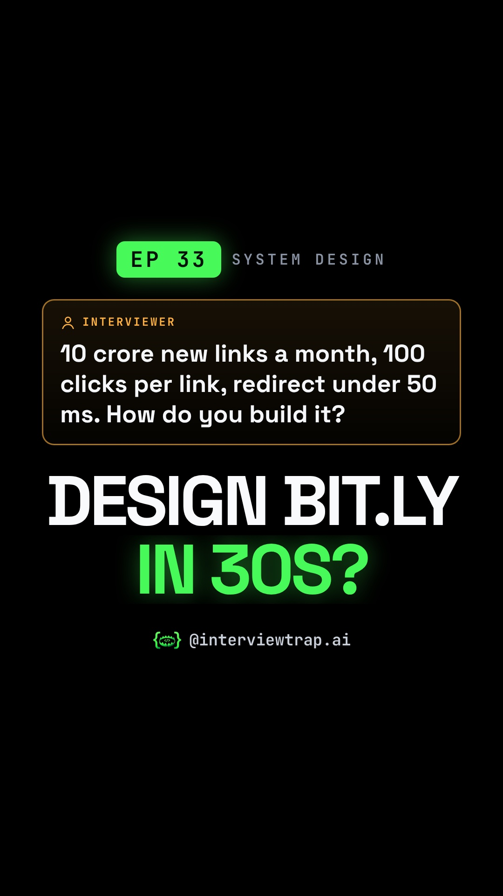

# EP 33 · Design bit.ly in 30 Seconds: URL Shortener System Design Interview Challenge (Season Finale)

| | |
|---|---|
| Category | System Design & Scaling |
| Duration | 80.8 s |
| Video | [30-second-challenge-design-bit-ly-answer-in-the-001.mp4](https://raw.githubusercontent.com/PunithVT/career-ops/main/interview-prep-videos/videos/30-second-challenge-design-bit-ly-answer-in-the-001.mp4) |
| Cover / thumbnail | [30-second-challenge-design-bit-ly-answer-in-the-001.jpg](https://raw.githubusercontent.com/PunithVT/career-ops/main/interview-prep-videos/covers/30-second-challenge-design-bit-ly-answer-in-the-001.jpg) |
| Subtitles | [30-second-challenge-design-bit-ly-answer-in-the-001.srt](https://raw.githubusercontent.com/PunithVT/career-ops/main/interview-prep-videos/subtitles/30-second-challenge-design-bit-ly-answer-in-the-001.srt) |



## Instagram caption
```
EP 33 · Season finale. 30 seconds: design a URL shortener like bit.ly. 10 crore new links a month, 100 clicks per link, redirect under 50 ms.

Pause the reel and post your design in the comments before you watch the answer.

What the interviewer listens for: estimates first (about 40 writes vs 4,000 reads a second, so read-heavy), a unique ID encoded in base62 instead of a truncated MD5 with no collision check (7 characters give about 3.5 trillion codes), a cache in front of the store, scrambled codes so nobody can walk other people's links, and leased ID ranges (or Snowflake IDs) when one counter becomes the bottleneck. Bonus: send 302, or a 301 with a short max-age like bit.ly does, so browsers don't cache the redirect for ages.

Send this to a friend who has a system design interview coming up.

Follow @interviewtrap.ai for daily interview traps.

Animated emoji: Noto Emoji Animation by Google, CC BY 4.0 (creativecommons.org/licenses/by/4.0). Modified (resized/re-timed).

#SystemDesign #URLShortener #SystemDesignInterview #BackendDevelopment #TechInterview #PlacementPrep #InterviewTrapAI
```

## YouTube Shorts
**Title:** EP 33 · Design bit.ly in 30 Seconds: URL Shortener System Design Interview Challenge #Shorts

**Description:**
```
EP 33 · Season finale. 30 seconds: design a URL shortener like bit.ly. 10 crore new links a month, 100 clicks per link, redirect under 50 ms.

Pause the reel and post your design in the comments before you watch the answer.

What the interviewer listens for: estimates first (about 40 writes vs 4,000 reads a second, so read-heavy), a unique ID encoded in base62 instead of a truncated MD5 with no collision check (7 characters give about 3.5 trillion codes), a cache in front of the store, scrambled codes so nobody can walk other people's links, and leased ID ranges (or Snowflake IDs) when one counter becomes the bottleneck. Bonus: send 302, or a 301 with a short max-age like bit.ly does, so browsers don't cache the redirect for ages.

Send this to a friend who has a system design interview coming up.

Follow @interviewtrap.ai for daily interview traps.

Animated emoji: Noto Emoji Animation by Google, CC BY 4.0 (creativecommons.org/licenses/by/4.0). Modified (resized/re-timed).

#SystemDesign #URLShortener #SystemDesignInterview #BackendDevelopment #TechInterview #PlacementPrep #InterviewTrapAI #Shorts
```
**Tags:** SystemDesign, URLShortener, SystemDesignInterview, BackendDevelopment, TechInterview, PlacementPrep, InterviewTrapAI, interview preparation, tech interview, Shorts
**Category:** Education · **AI voice disclosed:** yes · **Made for kids:** no

## Cover text
DESIGN BIT.LY IN 30s?
