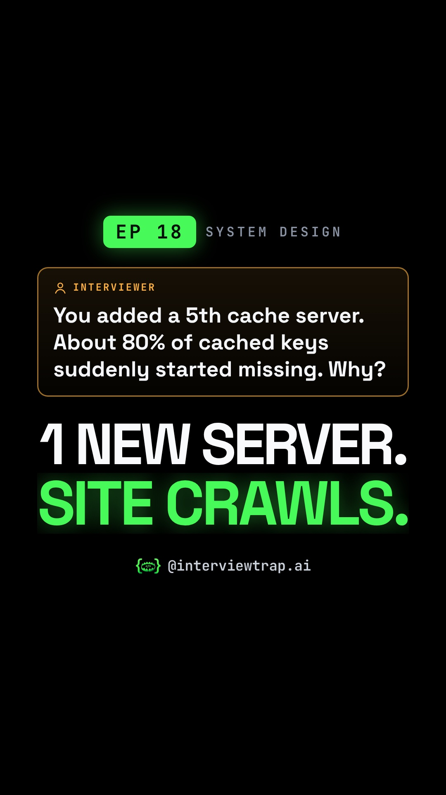

# EP 18 · Consistent Hashing Explained: Why Adding One Server Breaks 80% of Your Cache (System Design Interview)

| | |
|---|---|
| Category | System Design & Scaling |
| Duration | 79.1 s |
| Video | [add-one-server-lose-80-of-cache-consistent-hashi-001.mp4](https://raw.githubusercontent.com/PunithVT/career-ops/main/interview-prep-videos/videos/add-one-server-lose-80-of-cache-consistent-hashi-001.mp4) |
| Cover / thumbnail | [add-one-server-lose-80-of-cache-consistent-hashi-001.jpg](https://raw.githubusercontent.com/PunithVT/career-ops/main/interview-prep-videos/covers/add-one-server-lose-80-of-cache-consistent-hashi-001.jpg) |
| Subtitles | [add-one-server-lose-80-of-cache-consistent-hashi-001.srt](https://raw.githubusercontent.com/PunithVT/career-ops/main/interview-prep-videos/subtitles/add-one-server-lose-80-of-cache-consistent-hashi-001.srt) |



## Instagram caption
```
EP 18 · Add one cache server and about 80% of your lookups suddenly miss.

With hash(key) % N, going from 4 to 5 servers remaps about 80% of keys (N/(N+1) in general). The data isn't lost, but lookups go to the wrong server, miss, and all hit your database at once.

Consistent hashing puts servers and keys on a ring, so adding a server moves only about 1/(N+1) of keys on average, all to the new server. Virtual nodes keep the load even and let a bigger server take more keys.

Send this to a friend who has a system design round coming up. Comment 'RING' if you said 20%.

Follow @interviewtrap.ai for daily interview traps.

Animated emoji: Noto Emoji Animation by Google, CC BY 4.0 (creativecommons.org/licenses/by/4.0). Modified (resized/re-timed).

#SystemDesign #ConsistentHashing #DistributedSystems #Caching #TechInterview #PlacementPrep #InterviewTrapAI
```

## YouTube Shorts
**Title:** EP 18 · Consistent Hashing Explained: Why Adding One Server Breaks 80% of Your Cache #Shorts

**Description:**
```
EP 18 · Add one cache server and about 80% of your lookups suddenly miss.

With hash(key) % N, going from 4 to 5 servers remaps about 80% of keys (N/(N+1) in general). The data isn't lost, but lookups go to the wrong server, miss, and all hit your database at once.

Consistent hashing puts servers and keys on a ring, so adding a server moves only about 1/(N+1) of keys on average, all to the new server. Virtual nodes keep the load even and let a bigger server take more keys.

Send this to a friend who has a system design round coming up. Comment 'RING' if you said 20%.

Follow @interviewtrap.ai for daily interview traps.

Animated emoji: Noto Emoji Animation by Google, CC BY 4.0 (creativecommons.org/licenses/by/4.0). Modified (resized/re-timed).

#SystemDesign #ConsistentHashing #DistributedSystems #Caching #TechInterview #PlacementPrep #InterviewTrapAI #Shorts
```
**Tags:** SystemDesign, ConsistentHashing, DistributedSystems, Caching, TechInterview, PlacementPrep, InterviewTrapAI, interview preparation, tech interview, Shorts
**Category:** Education · **AI voice disclosed:** yes · **Made for kids:** no

## Cover text
1 NEW SERVER. SITE CRAWLS.
