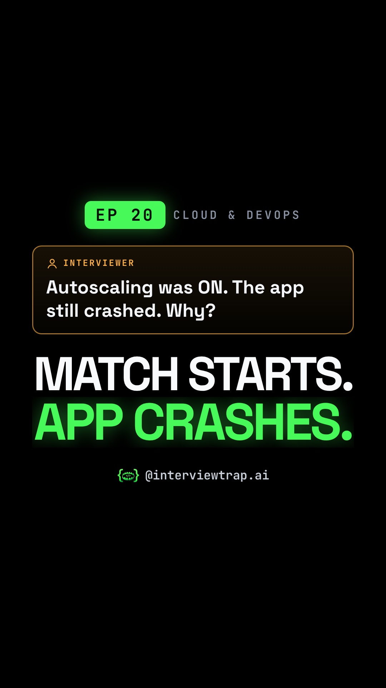

# EP 20 · Autoscaling Explained: Why It's Too Slow for an India-Pakistan Match (Cloud Interview Question)

| | |
|---|---|
| Category | Cloud & DevOps |
| Duration | 83.6 s |
| Video | [autoscaling-is-too-slow-for-an-india-pakistan-ma-001.mp4](https://raw.githubusercontent.com/PunithVT/career-ops/main/interview-prep-videos/videos/autoscaling-is-too-slow-for-an-india-pakistan-ma-001.mp4) |
| Cover / thumbnail | [autoscaling-is-too-slow-for-an-india-pakistan-ma-001.jpg](https://raw.githubusercontent.com/PunithVT/career-ops/main/interview-prep-videos/covers/autoscaling-is-too-slow-for-an-india-pakistan-ma-001.jpg) |
| Subtitles | [autoscaling-is-too-slow-for-an-india-pakistan-ma-001.srt](https://raw.githubusercontent.com/PunithVT/career-ops/main/interview-prep-videos/subtitles/autoscaling-is-too-slow-for-an-india-pakistan-ma-001.srt) |



## Instagram caption
```
EP 20 · Autoscaling was ON. The app still crashed. Why?

Reactive autoscaling waits for a metric, then an alarm, then a VM boot and health checks. That takes minutes. An India-Pakistan spike arrives in seconds. Think of a first-day-first-show with two ticket windows and a manager who only opens a third after the line has been long for several checks.

For a known match, pre-scale on a schedule and reserve capacity with your cloud and CDN partners. Video comes from the CDN; the load hits your APIs. Scale on concurrency and request rate, not just CPU, and size DB pools ahead, or extra servers only choke the database. Reportedly, Hotstar's engineers found stock autoscaling too slow and pre-scaled for record crowds (25.3M concurrent viewers in 2019).

Send this to a friend who has a system design interview coming up.

What would YOU answer in the interview? Comment below 👇

Follow @interviewtrap.ai for daily interview traps.

Animated emoji: Noto Emoji Animation by Google, CC BY 4.0 (creativecommons.org/licenses/by/4.0). Modified (resized/re-timed).

#SystemDesign #Autoscaling #DevOps #CloudComputing #TechInterview #CricketTech #InterviewTrapAI
```

## YouTube Shorts
**Title:** EP 20 · Autoscaling Explained: Why It's Too Slow for an India-Pakistan Match #Shorts

**Description:**
```
EP 20 · Autoscaling was ON. The app still crashed. Why?

Reactive autoscaling waits for a metric, then an alarm, then a VM boot and health checks. That takes minutes. An India-Pakistan spike arrives in seconds. Think of a first-day-first-show with two ticket windows and a manager who only opens a third after the line has been long for several checks.

For a known match, pre-scale on a schedule and reserve capacity with your cloud and CDN partners. Video comes from the CDN; the load hits your APIs. Scale on concurrency and request rate, not just CPU, and size DB pools ahead, or extra servers only choke the database. Reportedly, Hotstar's engineers found stock autoscaling too slow and pre-scaled for record crowds (25.3M concurrent viewers in 2019).

Send this to a friend who has a system design interview coming up.

What would YOU answer in the interview? Comment below 👇

Follow @interviewtrap.ai for daily interview traps.

Animated emoji: Noto Emoji Animation by Google, CC BY 4.0 (creativecommons.org/licenses/by/4.0). Modified (resized/re-timed).

#SystemDesign #Autoscaling #DevOps #CloudComputing #TechInterview #CricketTech #InterviewTrapAI #Shorts
```
**Tags:** SystemDesign, Autoscaling, DevOps, CloudComputing, TechInterview, CricketTech, InterviewTrapAI, interview preparation, tech interview, Shorts
**Category:** Education · **AI voice disclosed:** yes · **Made for kids:** no

## Cover text
MATCH STARTS. APP CRASHES.
