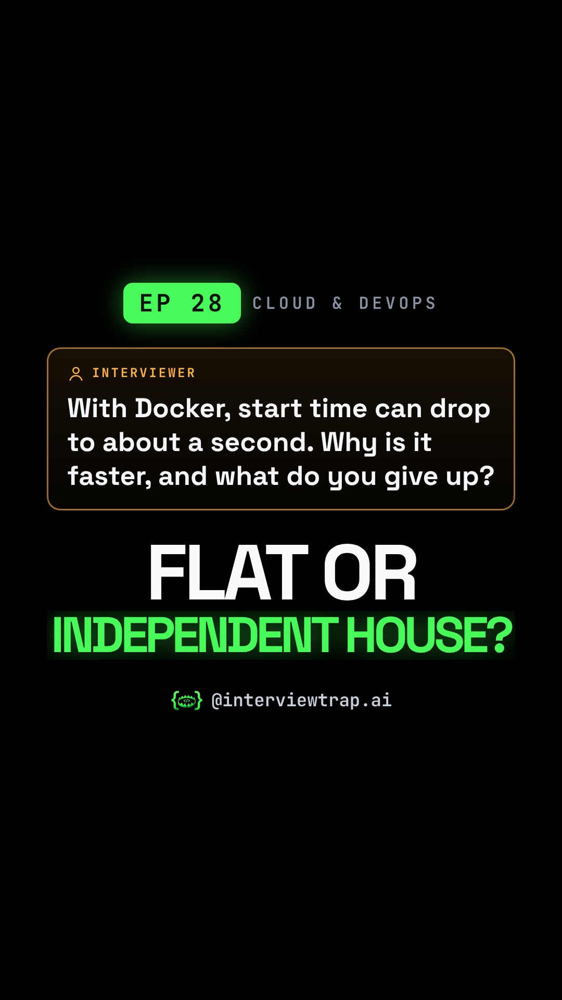

# EP 28 · Containers vs VMs Explained: Why Docker Boots in a Second (and What You Give Up) | DevOps Interview

| | |
|---|---|
| Category | Cloud & DevOps |
| Duration | 84.1 s |
| Video | [containers-vs-vms-flat-vs-independent-house-001.mp4](https://raw.githubusercontent.com/PunithVT/career-ops/main/interview-prep-videos/videos/containers-vs-vms-flat-vs-independent-house-001.mp4) |
| Cover / thumbnail | [containers-vs-vms-flat-vs-independent-house-001.jpg](https://raw.githubusercontent.com/PunithVT/career-ops/main/interview-prep-videos/covers/containers-vs-vms-flat-vs-independent-house-001.jpg) |
| Subtitles | [containers-vs-vms-flat-vs-independent-house-001.srt](https://raw.githubusercontent.com/PunithVT/career-ops/main/interview-prep-videos/subtitles/containers-vs-vms-flat-vs-independent-house-001.srt) |



## Instagram caption
```
EP 28 · 40 VMs, each booting a 2 GB OS in about a minute. With Docker, start time can drop to about a second. But most candidates explain WHY the wrong way. (Scenario numbers, not a benchmark.)

Think of a colony. A VM is an independent house: its own foundation (its own guest kernel) and its own boot. A container is a flat: it has its own lock, but the building's foundation, the host kernel, is shared. It is just a process. The walls decide what it can see (namespaces) and the water and power quota decides what it can use (cgroups). No OS to boot, so images are often MBs and start about as fast as the app.

The trap: a crack in the shared foundation, a kernel bug, can put every flat at risk. Never run --privileged, which is close to host root. The twist: for untrusted code, use microVMs like Firecracker (own minimal kernel, under 125 ms boot with a minimal config) or sandboxes like gVisor. That's why AWS Lambda runs functions in microVMs, never shared across AWS accounts.

Send this to a friend who has a DevOps or cloud interview coming up.

What would YOU answer in the interview? Comment below 👇

Follow @interviewtrap.ai for daily interview traps.

Animated emoji: Noto Emoji Animation by Google, CC BY 4.0 (creativecommons.org/licenses/by/4.0). Modified (resized/re-timed).

#Docker #DevOps #Containers #CloudComputing #TechInterview #SystemDesign #InterviewTrapAI
```

## YouTube Shorts
**Title:** EP 28 · Containers vs VMs Explained: Why Docker Boots in a Second (and What You Give Up) |… #Shorts

**Description:**
```
EP 28 · 40 VMs, each booting a 2 GB OS in about a minute. With Docker, start time can drop to about a second. But most candidates explain WHY the wrong way. (Scenario numbers, not a benchmark.)

Think of a colony. A VM is an independent house: its own foundation (its own guest kernel) and its own boot. A container is a flat: it has its own lock, but the building's foundation, the host kernel, is shared. It is just a process. The walls decide what it can see (namespaces) and the water and power quota decides what it can use (cgroups). No OS to boot, so images are often MBs and start about as fast as the app.

The trap: a crack in the shared foundation, a kernel bug, can put every flat at risk. Never run --privileged, which is close to host root. The twist: for untrusted code, use microVMs like Firecracker (own minimal kernel, under 125 ms boot with a minimal config) or sandboxes like gVisor. That's why AWS Lambda runs functions in microVMs, never shared across AWS accounts.

Send this to a friend who has a DevOps or cloud interview coming up.

What would YOU answer in the interview? Comment below 👇

Follow @interviewtrap.ai for daily interview traps.

Animated emoji: Noto Emoji Animation by Google, CC BY 4.0 (creativecommons.org/licenses/by/4.0). Modified (resized/re-timed).

#Docker #DevOps #Containers #CloudComputing #TechInterview #SystemDesign #InterviewTrapAI #Shorts
```
**Tags:** Docker, DevOps, Containers, CloudComputing, TechInterview, SystemDesign, InterviewTrapAI, interview preparation, tech interview, Shorts
**Category:** Education · **AI voice disclosed:** yes · **Made for kids:** no

## Cover text
FLAT OR INDEPENDENT HOUSE?
