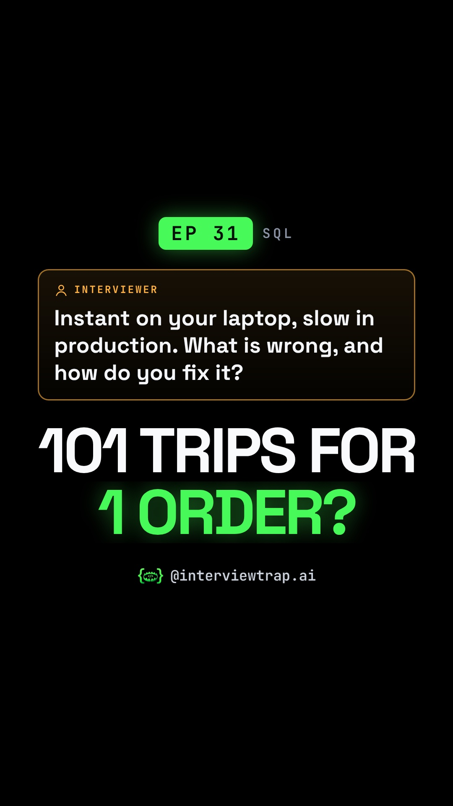

# EP 31 · The N+1 Query Problem Explained: Why One Loop Sent 101 Queries to Your Database (SQL / ORM Interview)

| | |
|---|---|
| Category | Databases & SQL |
| Duration | 77.2 s |
| Video | [delivery-boy-ne-101-chakkar-kyun-lagaye-the-n-pl-001.mp4](https://raw.githubusercontent.com/PunithVT/career-ops/main/interview-prep-videos/videos/delivery-boy-ne-101-chakkar-kyun-lagaye-the-n-pl-001.mp4) |
| Cover / thumbnail | [delivery-boy-ne-101-chakkar-kyun-lagaye-the-n-pl-001.jpg](https://raw.githubusercontent.com/PunithVT/career-ops/main/interview-prep-videos/covers/delivery-boy-ne-101-chakkar-kyun-lagaye-the-n-pl-001.jpg) |
| Subtitles | [delivery-boy-ne-101-chakkar-kyun-lagaye-the-n-pl-001.srt](https://raw.githubusercontent.com/PunithVT/career-ops/main/interview-prep-videos/subtitles/delivery-boy-ne-101-chakkar-kyun-lagaye-the-n-pl-001.srt) |



## Instagram caption
```
EP 31 · One loop in your code. 101 queries hit the database.

That's the N+1 problem. The ORM runs 1 query for 100 orders, then lazy loading fires 1 more query per order the first time you touch o.restaurant. On your laptop each round trip is about 0.1 ms, so it feels instant. In production a trip can cost 5 to 30 ms once network and connection-pool waits add up. The fix: a JOIN for many-to-one (select_related, JOIN FETCH), or one batched WHERE id IN query per relation (prefetch_related). Catch it with query-count assertions in tests.

The twist: JOIN every one-to-many relation eagerly and the rows multiply into a cartesian explosion.

Send this to a friend who has a backend interview coming up.

What would YOU answer in the interview? Comment below 👇

Follow @interviewtrap.ai for daily interview traps.

Animated emoji: Noto Emoji Animation by Google, CC BY 4.0 (creativecommons.org/licenses/by/4.0). Modified (resized/re-timed).

#SQL #NPlusOne #ORM #Django #BackendDevelopment #TechInterview #PlacementPrep #InterviewTrapAI
```

## YouTube Shorts
**Title:** EP 31 · The N+1 Query Problem Explained: Why One Loop Sent 101 Queries to Your Database #Shorts

**Description:**
```
EP 31 · One loop in your code. 101 queries hit the database.

That's the N+1 problem. The ORM runs 1 query for 100 orders, then lazy loading fires 1 more query per order the first time you touch o.restaurant. On your laptop each round trip is about 0.1 ms, so it feels instant. In production a trip can cost 5 to 30 ms once network and connection-pool waits add up. The fix: a JOIN for many-to-one (select_related, JOIN FETCH), or one batched WHERE id IN query per relation (prefetch_related). Catch it with query-count assertions in tests.

The twist: JOIN every one-to-many relation eagerly and the rows multiply into a cartesian explosion.

Send this to a friend who has a backend interview coming up.

What would YOU answer in the interview? Comment below 👇

Follow @interviewtrap.ai for daily interview traps.

Animated emoji: Noto Emoji Animation by Google, CC BY 4.0 (creativecommons.org/licenses/by/4.0). Modified (resized/re-timed).

#SQL #NPlusOne #ORM #Django #BackendDevelopment #TechInterview #PlacementPrep #InterviewTrapAI #Shorts
```
**Tags:** SQL, NPlusOne, ORM, Django, BackendDevelopment, TechInterview, PlacementPrep, InterviewTrapAI, interview preparation, tech interview, Shorts
**Category:** Education · **AI voice disclosed:** yes · **Made for kids:** no

## Cover text
101 TRIPS FOR 1 ORDER?
