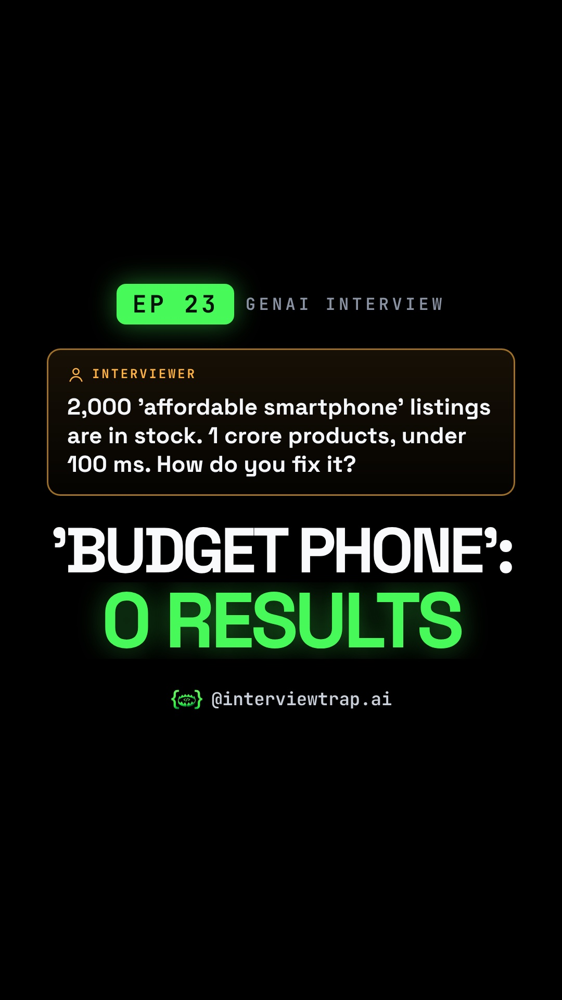

# EP 23 · Embeddings Explained: How Search Knows 'Budget Phone' Means 'Cheap Mobile' (Vector Search Interview)

| | |
|---|---|
| Category | AI Engineering |
| Duration | 80.9 s |
| Video | [embeddings-how-search-knows-budget-phone-means-c-001.mp4](https://raw.githubusercontent.com/PunithVT/career-ops/main/interview-prep-videos/videos/embeddings-how-search-knows-budget-phone-means-c-001.mp4) |
| Cover / thumbnail | [embeddings-how-search-knows-budget-phone-means-c-001.jpg](https://raw.githubusercontent.com/PunithVT/career-ops/main/interview-prep-videos/covers/embeddings-how-search-knows-budget-phone-means-c-001.jpg) |
| Subtitles | [embeddings-how-search-knows-budget-phone-means-c-001.srt](https://raw.githubusercontent.com/PunithVT/career-ops/main/interview-prep-videos/subtitles/embeddings-how-search-knows-budget-phone-means-c-001.srt) |



## Instagram caption
```
EP 23 · 'Budget phone' returns zero results while 2,000 'affordable smartphones' sit in stock. Why?

LIKE matches words, not meaning, and 1 crore products won't fit in any LLM context window. Embeddings give every product a position by meaning, like a hypermarket where cheap mobiles sit next to affordable smartphones. Embed the query with the same model and return its nearest neighbours; an HNSW index gets there without checking every product.

The trap: similar is not correct. 'With notch' can land next to 'without notch', and model numbers can match poorly, so production search is hybrid: BM25 plus vectors, merged, then re-ranked. Switch embedding models and you re-embed the whole catalogue. And 95% recall from ANN is a trade-off you tune, not a bug.

Send this to a friend who has a GenAI or search interview coming up.

What would YOU answer in the interview? Comment below 👇

Follow @interviewtrap.ai for daily interview traps.

Animated emoji: Noto Emoji Animation by Google, CC BY 4.0 (creativecommons.org/licenses/by/4.0). Modified (resized/re-timed).

#Embeddings #VectorSearch #GenAI #AIEngineering #RAG #TechInterview #SystemDesign #InterviewTrapAI
```

## YouTube Shorts
**Title:** EP 23 · Embeddings Explained: How Search Knows 'Budget Phone' Means 'Cheap Mobile' #Shorts

**Description:**
```
EP 23 · 'Budget phone' returns zero results while 2,000 'affordable smartphones' sit in stock. Why?

LIKE matches words, not meaning, and 1 crore products won't fit in any LLM context window. Embeddings give every product a position by meaning, like a hypermarket where cheap mobiles sit next to affordable smartphones. Embed the query with the same model and return its nearest neighbours; an HNSW index gets there without checking every product.

The trap: similar is not correct. 'With notch' can land next to 'without notch', and model numbers can match poorly, so production search is hybrid: BM25 plus vectors, merged, then re-ranked. Switch embedding models and you re-embed the whole catalogue. And 95% recall from ANN is a trade-off you tune, not a bug.

Send this to a friend who has a GenAI or search interview coming up.

What would YOU answer in the interview? Comment below 👇

Follow @interviewtrap.ai for daily interview traps.

Animated emoji: Noto Emoji Animation by Google, CC BY 4.0 (creativecommons.org/licenses/by/4.0). Modified (resized/re-timed).

#Embeddings #VectorSearch #GenAI #AIEngineering #RAG #TechInterview #SystemDesign #InterviewTrapAI #Shorts
```
**Tags:** Embeddings, VectorSearch, GenAI, AIEngineering, RAG, TechInterview, SystemDesign, InterviewTrapAI, interview preparation, tech interview, Shorts
**Category:** Education · **AI voice disclosed:** yes · **Made for kids:** no

## Cover text
'BUDGET PHONE': 0 RESULTS
