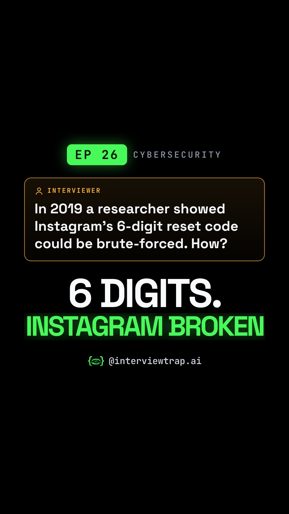

# EP 26 · How Instagram's 6-Digit OTP Was Brute-Forced (Rate Limiting Interview Question)

| | |
|---|---|
| Category | Cybersecurity |
| Duration | 83.6 s |
| Video | [how-a-chennai-researcher-broke-instagram-s-6-dig-001.mp4](https://raw.githubusercontent.com/PunithVT/career-ops/main/interview-prep-videos/videos/how-a-chennai-researcher-broke-instagram-s-6-dig-001.mp4) |
| Cover / thumbnail | [how-a-chennai-researcher-broke-instagram-s-6-dig-001.jpg](https://raw.githubusercontent.com/PunithVT/career-ops/main/interview-prep-videos/covers/how-a-chennai-researcher-broke-instagram-s-6-dig-001.jpg) |
| Subtitles | [how-a-chennai-researcher-broke-instagram-s-6-dig-001.srt](https://raw.githubusercontent.com/PunithVT/career-ops/main/interview-prep-videos/subtitles/how-a-chennai-researcher-broke-instagram-s-6-dig-001.srt) |



## Instagram caption
```
EP 26 · A 6-digit code. A per-IP rate limit. And it still wasn't safe.

In 2019, security researcher Laxman Muthiyah showed that Instagram's 6-digit mobile password-reset code could be brute-forced. He tested on a test account, sent about 2 lakh guesses from 1,000 IPs using a race condition plus IP rotation, estimated that 5,000 IPs would cover every code, reported it through Facebook's bug bounty and was paid $30,000.

The interview version: 6-digit OTP, valid 10 minutes, 200 attempts per IP, attacker with 5,000 IPs. 5,000 x 200 = 10 lakh guesses inside the window, which is every code. Think of a gym locker whose trainer allows 200 tries per person: a gang of 5,000 walks right through. Count on the locker instead (the account and the OTP), kill the code after 5 misses, and never lock the account, or anyone can lock anyone out (lockout DoS). Keep the counter shared and atomic (one Redis Lua script), or every server's diary multiplies the limit.

Send this to a friend who has a security or backend interview coming up.

What would YOU answer in the interview? Comment below 👇

Follow @interviewtrap.ai for daily interview traps.

Animated emoji: Noto Emoji Animation by Google, CC BY 4.0 (creativecommons.org/licenses/by/4.0). Modified (resized/re-timed).

#CyberSecurity #RateLimiting #SystemDesign #BugBounty #TechInterview #Redis #InterviewTrapAI
```

## YouTube Shorts
**Title:** EP 26 · How Instagram's 6-Digit OTP Was Brute-Forced (Rate Limiting Interview Question) #Shorts

**Description:**
```
EP 26 · A 6-digit code. A per-IP rate limit. And it still wasn't safe.

In 2019, security researcher Laxman Muthiyah showed that Instagram's 6-digit mobile password-reset code could be brute-forced. He tested on a test account, sent about 2 lakh guesses from 1,000 IPs using a race condition plus IP rotation, estimated that 5,000 IPs would cover every code, reported it through Facebook's bug bounty and was paid $30,000.

The interview version: 6-digit OTP, valid 10 minutes, 200 attempts per IP, attacker with 5,000 IPs. 5,000 x 200 = 10 lakh guesses inside the window, which is every code. Think of a gym locker whose trainer allows 200 tries per person: a gang of 5,000 walks right through. Count on the locker instead (the account and the OTP), kill the code after 5 misses, and never lock the account, or anyone can lock anyone out (lockout DoS). Keep the counter shared and atomic (one Redis Lua script), or every server's diary multiplies the limit.

Send this to a friend who has a security or backend interview coming up.

What would YOU answer in the interview? Comment below 👇

Follow @interviewtrap.ai for daily interview traps.

Animated emoji: Noto Emoji Animation by Google, CC BY 4.0 (creativecommons.org/licenses/by/4.0). Modified (resized/re-timed).

#CyberSecurity #RateLimiting #SystemDesign #BugBounty #TechInterview #Redis #InterviewTrapAI #Shorts
```
**Tags:** CyberSecurity, RateLimiting, SystemDesign, BugBounty, TechInterview, Redis, InterviewTrapAI, interview preparation, tech interview, Shorts
**Category:** Education · **AI voice disclosed:** yes · **Made for kids:** no

## Cover text
6 DIGITS. INSTAGRAM BROKEN
