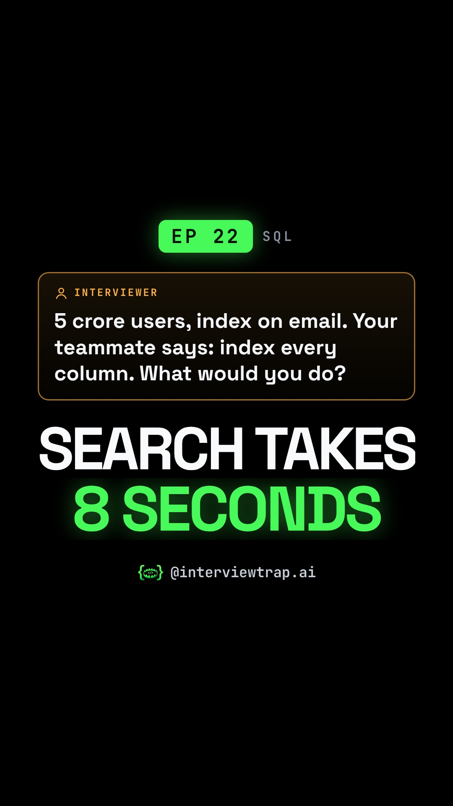

# EP 22 · Database Index Explained: Index Added, Query Still 8 Seconds? (LOWER(), Leftmost Prefix, SQL Interview)

| | |
|---|---|
| Category | Databases & SQL |
| Duration | 85.5 s |
| Video | [index-lagaya-phir-bhi-query-8-second-001.mp4](https://raw.githubusercontent.com/PunithVT/career-ops/main/interview-prep-videos/videos/index-lagaya-phir-bhi-query-8-second-001.mp4) |
| Cover / thumbnail | [index-lagaya-phir-bhi-query-8-second-001.jpg](https://raw.githubusercontent.com/PunithVT/career-ops/main/interview-prep-videos/covers/index-lagaya-phir-bhi-query-8-second-001.jpg) |
| Subtitles | [index-lagaya-phir-bhi-query-8-second-001.srt](https://raw.githubusercontent.com/PunithVT/career-ops/main/interview-prep-videos/subtitles/index-lagaya-phir-bhi-query-8-second-001.srt) |



## Instagram caption
```
EP 22 · Index on email. Query still takes 8 seconds. Why?

The query says WHERE LOWER(email) = ?. The index stores email as typed, not LOWER(email), so the database silently skips it and scans every row. Fix: an expression index on LOWER(email), then confirm with EXPLAIN that the plan says Index Scan.

'Index every column' fails too: every insert has to update every index, and each one costs disk and memory. Follow-up: an index on (city, age) usually can't seek on age alone. That's the leftmost prefix rule. Put equality columns first and range columns last.

Send this to a friend who has a SQL or backend interview coming up.

What would YOU answer in the interview? Comment below 👇

Follow @interviewtrap.ai for daily interview traps.

Animated emoji: Noto Emoji Animation by Google, CC BY 4.0 (creativecommons.org/licenses/by/4.0). Modified (resized/re-timed).

#SQL #DatabaseIndexing #PostgreSQL #MySQL #TechInterview #PlacementPrep #InterviewTrapAI
```

## YouTube Shorts
**Title:** EP 22 · Database Index Explained: Index Added, Query Still 8 Seconds? (LOWER(), Leftmost… #Shorts

**Description:**
```
EP 22 · Index on email. Query still takes 8 seconds. Why?

The query says WHERE LOWER(email) = ?. The index stores email as typed, not LOWER(email), so the database silently skips it and scans every row. Fix: an expression index on LOWER(email), then confirm with EXPLAIN that the plan says Index Scan.

'Index every column' fails too: every insert has to update every index, and each one costs disk and memory. Follow-up: an index on (city, age) usually can't seek on age alone. That's the leftmost prefix rule. Put equality columns first and range columns last.

Send this to a friend who has a SQL or backend interview coming up.

What would YOU answer in the interview? Comment below 👇

Follow @interviewtrap.ai for daily interview traps.

Animated emoji: Noto Emoji Animation by Google, CC BY 4.0 (creativecommons.org/licenses/by/4.0). Modified (resized/re-timed).

#SQL #DatabaseIndexing #PostgreSQL #MySQL #TechInterview #PlacementPrep #InterviewTrapAI #Shorts
```
**Tags:** SQL, DatabaseIndexing, PostgreSQL, MySQL, TechInterview, PlacementPrep, InterviewTrapAI, interview preparation, tech interview, Shorts
**Category:** Education · **AI voice disclosed:** yes · **Made for kids:** no

## Cover text
SEARCH TAKES 8 SECONDS
