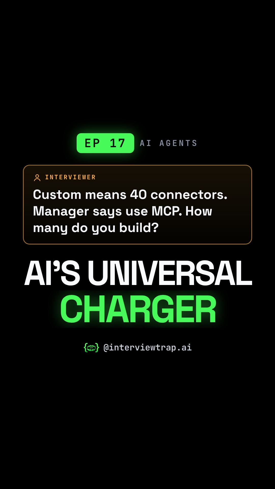

# EP 17 · MCP Explained: 40 Custom Connectors, Only 14 Build Jobs (Model Context Protocol Interview Question)

| | |
|---|---|
| Category | AI Agents & Automation |
| Duration | 83.6 s |
| Video | [mcp-why-the-biggest-ai-companies-agreed-on-one-p-001.mp4](https://raw.githubusercontent.com/PunithVT/career-ops/main/interview-prep-videos/videos/mcp-why-the-biggest-ai-companies-agreed-on-one-p-001.mp4) |
| Cover / thumbnail | [mcp-why-the-biggest-ai-companies-agreed-on-one-p-001.jpg](https://raw.githubusercontent.com/PunithVT/career-ops/main/interview-prep-videos/covers/mcp-why-the-biggest-ai-companies-agreed-on-one-p-001.jpg) |
| Subtitles | [mcp-why-the-biggest-ai-companies-agreed-on-one-p-001.srt](https://raw.githubusercontent.com/PunithVT/career-ops/main/interview-prep-videos/subtitles/mcp-why-the-biggest-ai-companies-agreed-on-one-p-001.srt) |



## Instagram caption
```
EP 17 · 40 builds, or just 14? This MCP question catches a lot of candidates.

Your company has 4 AI apps and 10 internal tools. Custom work means 4 × 10 = 40 connectors. With MCP (Model Context Protocol), each tool is wrapped once as an MCP server and each app adds MCP client support once, becoming an MCP host: roughly 4 + 10 = 14 build jobs, often fewer with off-the-shelf servers. Runtime connections are still 40, but they are generic. Think of one standard plug instead of a drawer full of makeshift adapters.

The trap: MCP is a protocol, not a model, and it does not replace tool calling. The model still makes an ordinary tool call; the host's MCP client sends it to the server as tools/call, and the server executes it. MCP standardizes discovery and invocation. Tool descriptions land straight in the model's context, so a poisoned server can hide instructions there. Vet servers, pin versions, use least-privilege tokens. One app calling one function? Registering it directly as a tool is simpler.

Send this to a friend who has an AI engineering interview coming up.

What would YOU answer in the interview? Comment below 👇

Follow @interviewtrap.ai for daily interview traps.

Animated emoji: Noto Emoji Animation by Google, CC BY 4.0 (creativecommons.org/licenses/by/4.0). Modified (resized/re-timed).

#MCP #ModelContextProtocol #AIAgents #GenAI #TechInterview #SoftwareEngineering #InterviewTrapAI
```

## YouTube Shorts
**Title:** EP 17 · MCP Explained: 40 Custom Connectors, Only 14 Build Jobs #Shorts

**Description:**
```
EP 17 · 40 builds, or just 14? This MCP question catches a lot of candidates.

Your company has 4 AI apps and 10 internal tools. Custom work means 4 × 10 = 40 connectors. With MCP (Model Context Protocol), each tool is wrapped once as an MCP server and each app adds MCP client support once, becoming an MCP host: roughly 4 + 10 = 14 build jobs, often fewer with off-the-shelf servers. Runtime connections are still 40, but they are generic. Think of one standard plug instead of a drawer full of makeshift adapters.

The trap: MCP is a protocol, not a model, and it does not replace tool calling. The model still makes an ordinary tool call; the host's MCP client sends it to the server as tools/call, and the server executes it. MCP standardizes discovery and invocation. Tool descriptions land straight in the model's context, so a poisoned server can hide instructions there. Vet servers, pin versions, use least-privilege tokens. One app calling one function? Registering it directly as a tool is simpler.

Send this to a friend who has an AI engineering interview coming up.

What would YOU answer in the interview? Comment below 👇

Follow @interviewtrap.ai for daily interview traps.

Animated emoji: Noto Emoji Animation by Google, CC BY 4.0 (creativecommons.org/licenses/by/4.0). Modified (resized/re-timed).

#MCP #ModelContextProtocol #AIAgents #GenAI #TechInterview #SoftwareEngineering #InterviewTrapAI #Shorts
```
**Tags:** MCP, ModelContextProtocol, AIAgents, GenAI, TechInterview, SoftwareEngineering, InterviewTrapAI, interview preparation, tech interview, Shorts
**Category:** Education · **AI voice disclosed:** yes · **Made for kids:** no

## Cover text
AI'S UNIVERSAL CHARGER
