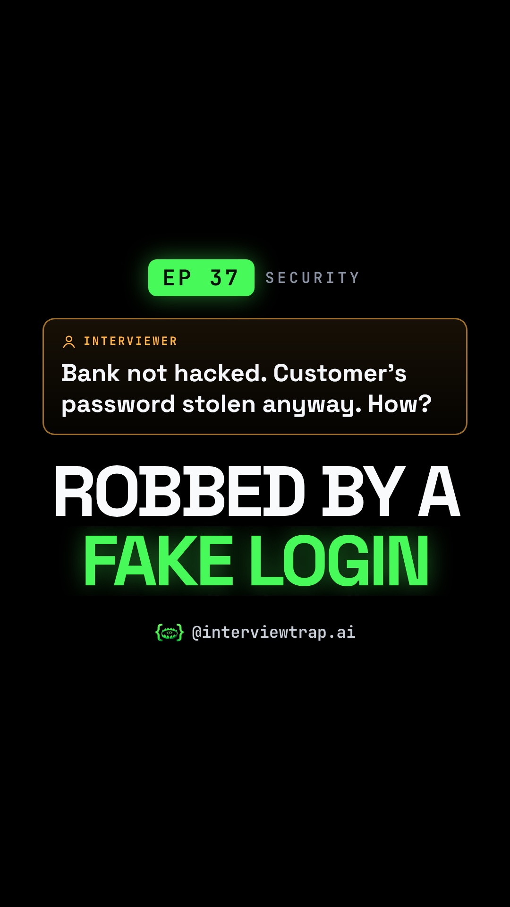

# EP 37 · Phishing Explained: Why the Padlock Doesn't Mean Safe (Lookalike Login Pages, OTP Relay, Passkeys) | Security Interview

| | |
|---|---|
| Category | Cybersecurity |
| Duration | 87.6 s |
| Video | [password-stolen-without-hacking-the-lookalike-lo-001.mp4](https://raw.githubusercontent.com/PunithVT/career-ops/main/interview-prep-videos/videos/password-stolen-without-hacking-the-lookalike-lo-001.mp4) |
| Cover / thumbnail | [password-stolen-without-hacking-the-lookalike-lo-001.jpg](https://raw.githubusercontent.com/PunithVT/career-ops/main/interview-prep-videos/covers/password-stolen-without-hacking-the-lookalike-lo-001.jpg) |
| Subtitles | [password-stolen-without-hacking-the-lookalike-lo-001.srt](https://raw.githubusercontent.com/PunithVT/career-ops/main/interview-prep-videos/subtitles/password-stolen-without-hacking-the-lookalike-lo-001.srt) |



## Instagram caption
```
EP 37 · Nobody hacked the bank. The customer typed his own password into sbi-kyc-update.in, a lookalike login page with the same signboard as the real one.

The padlock fooled him. It only means the connection is encrypted, not that the site is genuine, and criminals get free HTTPS too. Domain-bound credentials like passkeys and FIDO2 keys refuse to sign in on the wrong domain, but only if the weaker fallback logins are removed.

The bank also sends an OTP. Does the OTP save him, yes or no? 👇

Send this to a friend who has an interview coming up.

Follow @interviewtrap.ai for daily interview traps.

Animated emoji: Noto Emoji Animation by Google, CC BY 4.0 (creativecommons.org/licenses/by/4.0). Modified (resized/re-timed).

#cybersecurity #phishing #passkeys #webauthn #infosec #techinterview #InterviewTrapAI
```

## YouTube Shorts
**Title:** EP 37 · Phishing Explained: Why the Padlock Doesn't Mean Safe (Lookalike Login Pages, OTP… #Shorts

**Description:**
```
EP 37 · Nobody hacked the bank. The customer typed his own password into sbi-kyc-update.in, a lookalike login page with the same signboard as the real one.

The padlock fooled him. It only means the connection is encrypted, not that the site is genuine, and criminals get free HTTPS too. Domain-bound credentials like passkeys and FIDO2 keys refuse to sign in on the wrong domain, but only if the weaker fallback logins are removed.

The bank also sends an OTP. Does the OTP save him, yes or no? 👇

Send this to a friend who has an interview coming up.

Follow @interviewtrap.ai for daily interview traps.

Animated emoji: Noto Emoji Animation by Google, CC BY 4.0 (creativecommons.org/licenses/by/4.0). Modified (resized/re-timed).

#cybersecurity #phishing #passkeys #webauthn #infosec #techinterview #InterviewTrapAI #Shorts
```
**Tags:** cybersecurity, phishing, passkeys, webauthn, infosec, techinterview, InterviewTrapAI, interview preparation, tech interview, Shorts
**Category:** Education · **AI voice disclosed:** yes · **Made for kids:** no

## Cover text
ROBBED BY A FAKE LOGIN
