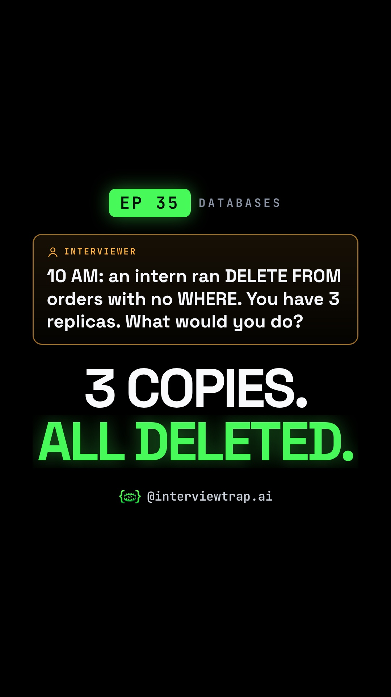

# EP 35 · Replication Is Not a Backup: One DELETE Wiped All 3 Replicas (PITR, Database Interview Question)

| | |
|---|---|
| Category | Databases & SQL |
| Duration | 89.3 s |
| Video | [replication-is-not-a-backup-001.mp4](https://raw.githubusercontent.com/PunithVT/career-ops/main/interview-prep-videos/videos/replication-is-not-a-backup-001.mp4) |
| Cover / thumbnail | [replication-is-not-a-backup-001.jpg](https://raw.githubusercontent.com/PunithVT/career-ops/main/interview-prep-videos/covers/replication-is-not-a-backup-001.jpg) |
| Subtitles | [replication-is-not-a-backup-001.srt](https://raw.githubusercontent.com/PunithVT/career-ops/main/interview-prep-videos/subtitles/replication-is-not-a-backup-001.srt) |



## Instagram caption
```
EP 35 · 3 replicas. One DELETE. Zero orders everywhere.

Replication keeps your app alive when a server dies. But it sends every write to every replica, including a DELETE with no WHERE. Replicas protect availability. They do not protect your data from mistakes.

What saves you is backups plus point-in-time recovery. You restore last night's base backup, then replay the WAL up to 09:59, one minute before the mistake. And a backup you have never test-restored is just a hope. GitLab learned this the hard way in 2017.

What would YOU answer in the interview? Comment below 👇

Send this to a friend who has a backend interview coming up.
Follow @interviewtrap.ai for daily interview traps.

Animated emoji: Noto Emoji Animation by Google, CC BY 4.0 (creativecommons.org/licenses/by/4.0). Modified (resized/re-timed).

#Database #SQL #PostgreSQL #SystemDesign #TechInterview #BackendDeveloper #InterviewTrapAI
```

## YouTube Shorts
**Title:** EP 35 · Replication Is Not a Backup: One DELETE Wiped All 3 Replicas #Shorts

**Description:**
```
EP 35 · 3 replicas. One DELETE. Zero orders everywhere.

Replication keeps your app alive when a server dies. But it sends every write to every replica, including a DELETE with no WHERE. Replicas protect availability. They do not protect your data from mistakes.

What saves you is backups plus point-in-time recovery. You restore last night's base backup, then replay the WAL up to 09:59, one minute before the mistake. And a backup you have never test-restored is just a hope. GitLab learned this the hard way in 2017.

What would YOU answer in the interview? Comment below 👇

Send this to a friend who has a backend interview coming up.
Follow @interviewtrap.ai for daily interview traps.

Animated emoji: Noto Emoji Animation by Google, CC BY 4.0 (creativecommons.org/licenses/by/4.0). Modified (resized/re-timed).

#Database #SQL #PostgreSQL #SystemDesign #TechInterview #BackendDeveloper #InterviewTrapAI #Shorts
```
**Tags:** Database, SQL, PostgreSQL, SystemDesign, TechInterview, BackendDeveloper, InterviewTrapAI, interview preparation, tech interview, Shorts
**Category:** Education · **AI voice disclosed:** yes · **Made for kids:** no

## Cover text
3 COPIES. ALL DELETED.
