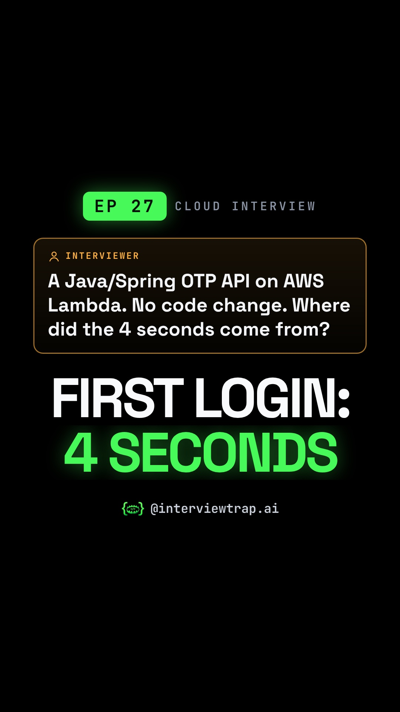

# EP 27 · Serverless Cold Start Explained: Why the First Login Is Always Late (AWS Lambda Interview Question)

| | |
|---|---|
| Category | Cloud & DevOps |
| Duration | 81.8 s |
| Video | [serverless-cold-start-the-first-login-is-always-001.mp4](https://raw.githubusercontent.com/PunithVT/career-ops/main/interview-prep-videos/videos/serverless-cold-start-the-first-login-is-always-001.mp4) |
| Cover / thumbnail | [serverless-cold-start-the-first-login-is-always-001.jpg](https://raw.githubusercontent.com/PunithVT/career-ops/main/interview-prep-videos/covers/serverless-cold-start-the-first-login-is-always-001.jpg) |
| Subtitles | [serverless-cold-start-the-first-login-is-always-001.srt](https://raw.githubusercontent.com/PunithVT/career-ops/main/interview-prep-videos/subtitles/serverless-cold-start-the-first-login-is-always-001.srt) |



## Instagram caption
```
EP 27 · Same code. 80 ms at noon, 4 seconds on the first login of the morning. Where did the delay come from? (Illustrative numbers.)

Think of the colony press wala. The shirt is the request, the iron is Lambda's execution environment. In the morning the iron is cold: light the coal, heat the iron. That's a cold start: a Firecracker microVM, your code download, the JVM start and your init code, all before the handler runs. The pressing itself takes 80 ms. The next shirt finds a hot iron: a warm start.

The trap: one iron presses one shirt at a time. A wedding rush of 10 shirts means up to 10 cold starts at once. Keeping every iron hot all day is provisioned concurrency, and you pay for it even when idle. Since August 2025, AWS also bills the INIT phase for on-demand functions on managed runtimes with ZIP packages. The twist: spiky traffic suits Lambda plus SnapStart (re-create DB connections after a snapshot restore, and note SnapStart can't be combined with provisioned concurrency); steady traffic with a strict SLA often suits always-on containers.

Send this to a friend who has a cloud or backend interview coming up.

What would YOU answer in the interview? Comment below 👇

Follow @interviewtrap.ai for daily interview traps.

Animated emoji: Noto Emoji Animation by Google, CC BY 4.0 (creativecommons.org/licenses/by/4.0). Modified (resized/re-timed).

#AWSLambda #Serverless #ColdStart #CloudComputing #TechInterview #SystemDesign #InterviewTrapAI
```

## YouTube Shorts
**Title:** EP 27 · Serverless Cold Start Explained: Why the First Login Is Always Late #Shorts

**Description:**
```
EP 27 · Same code. 80 ms at noon, 4 seconds on the first login of the morning. Where did the delay come from? (Illustrative numbers.)

Think of the colony press wala. The shirt is the request, the iron is Lambda's execution environment. In the morning the iron is cold: light the coal, heat the iron. That's a cold start: a Firecracker microVM, your code download, the JVM start and your init code, all before the handler runs. The pressing itself takes 80 ms. The next shirt finds a hot iron: a warm start.

The trap: one iron presses one shirt at a time. A wedding rush of 10 shirts means up to 10 cold starts at once. Keeping every iron hot all day is provisioned concurrency, and you pay for it even when idle. Since August 2025, AWS also bills the INIT phase for on-demand functions on managed runtimes with ZIP packages. The twist: spiky traffic suits Lambda plus SnapStart (re-create DB connections after a snapshot restore, and note SnapStart can't be combined with provisioned concurrency); steady traffic with a strict SLA often suits always-on containers.

Send this to a friend who has a cloud or backend interview coming up.

What would YOU answer in the interview? Comment below 👇

Follow @interviewtrap.ai for daily interview traps.

Animated emoji: Noto Emoji Animation by Google, CC BY 4.0 (creativecommons.org/licenses/by/4.0). Modified (resized/re-timed).

#AWSLambda #Serverless #ColdStart #CloudComputing #TechInterview #SystemDesign #InterviewTrapAI #Shorts
```
**Tags:** AWSLambda, Serverless, ColdStart, CloudComputing, TechInterview, SystemDesign, InterviewTrapAI, interview preparation, tech interview, Shorts
**Category:** Education · **AI voice disclosed:** yes · **Made for kids:** no

## Cover text
FIRST LOGIN: 4 SECONDS
