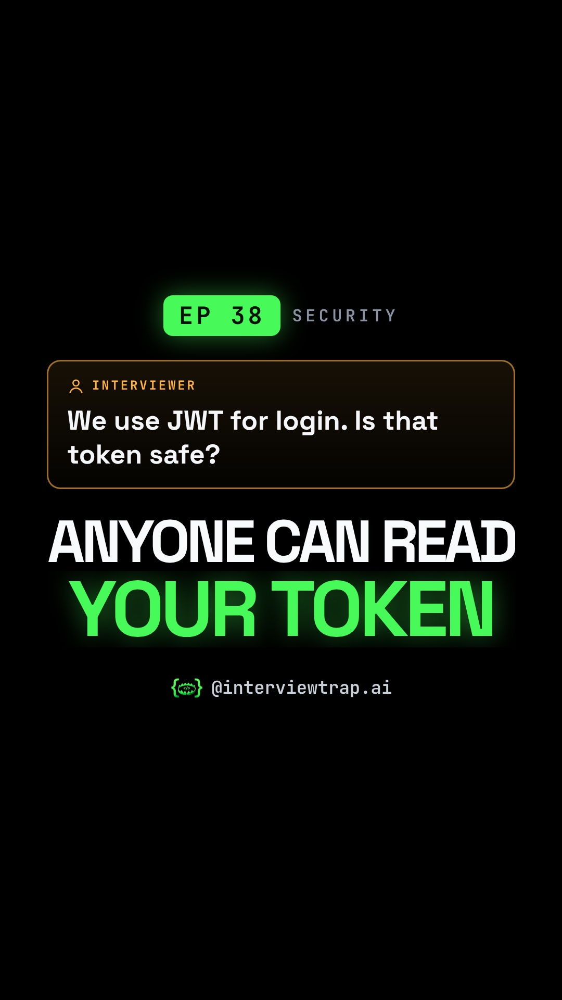

# EP 38 · JWT Explained: Signed, Not Encrypted. Why Anyone Can Read Your Login Token (Sessions vs JWT Interview)

| | |
|---|---|
| Category | Cybersecurity |
| Duration | 92.3 s |
| Video | [sessions-vs-jwt-signed-not-encrypted-001.mp4](https://raw.githubusercontent.com/PunithVT/career-ops/main/interview-prep-videos/videos/sessions-vs-jwt-signed-not-encrypted-001.mp4) |
| Cover / thumbnail | [sessions-vs-jwt-signed-not-encrypted-001.jpg](https://raw.githubusercontent.com/PunithVT/career-ops/main/interview-prep-videos/covers/sessions-vs-jwt-signed-not-encrypted-001.jpg) |
| Subtitles | [sessions-vs-jwt-signed-not-encrypted-001.srt](https://raw.githubusercontent.com/PunithVT/career-ops/main/interview-prep-videos/subtitles/sessions-vs-jwt-signed-not-encrypted-001.srt) |



## Instagram caption
```
EP 38 · Paste a login token into jwt.io and the user's email and role show up. No key needed.

Most login JWTs are signed (JWS), not encrypted. The signature proves who issued the token and that nobody changed it, but the payload is only base64url-encoded. Never put passwords, API keys or private data inside. (Encrypted JWTs do exist. They're called JWE, but most login tokens aren't JWE.)

Keep access tokens short-lived and use refresh tokens you can revoke. When instant logout matters, use server-side sessions with random, meaningless IDs, or add a jti denylist and accept that it brings server state back. And practise with test tokens only. Never paste real tokens into third-party sites.

Rahul's token gets stolen. He logs out. Does the thief's copy still work, yes or no? 👇

Send this to a friend who has an interview coming up.
Follow @interviewtrap.ai for daily interview traps.

Animated emoji: Noto Emoji Animation by Google, CC BY 4.0 (creativecommons.org/licenses/by/4.0). Modified (resized/re-timed).

#JWT #WebSecurity #Cybersecurity #Authentication #CodingInterview #BackendDevelopment #InterviewTrapAI
```

## YouTube Shorts
**Title:** EP 38 · JWT Explained: Signed, Not Encrypted. Why Anyone Can Read Your Login Token #Shorts

**Description:**
```
EP 38 · Paste a login token into jwt.io and the user's email and role show up. No key needed.

Most login JWTs are signed (JWS), not encrypted. The signature proves who issued the token and that nobody changed it, but the payload is only base64url-encoded. Never put passwords, API keys or private data inside. (Encrypted JWTs do exist. They're called JWE, but most login tokens aren't JWE.)

Keep access tokens short-lived and use refresh tokens you can revoke. When instant logout matters, use server-side sessions with random, meaningless IDs, or add a jti denylist and accept that it brings server state back. And practise with test tokens only. Never paste real tokens into third-party sites.

Rahul's token gets stolen. He logs out. Does the thief's copy still work, yes or no? 👇

Send this to a friend who has an interview coming up.
Follow @interviewtrap.ai for daily interview traps.

Animated emoji: Noto Emoji Animation by Google, CC BY 4.0 (creativecommons.org/licenses/by/4.0). Modified (resized/re-timed).

#JWT #WebSecurity #Cybersecurity #Authentication #CodingInterview #BackendDevelopment #InterviewTrapAI #Shorts
```
**Tags:** JWT, WebSecurity, Cybersecurity, Authentication, CodingInterview, BackendDevelopment, InterviewTrapAI, interview preparation, tech interview, Shorts
**Category:** Education · **AI voice disclosed:** yes · **Made for kids:** no

## Cover text
ANYONE CAN READ YOUR TOKEN
