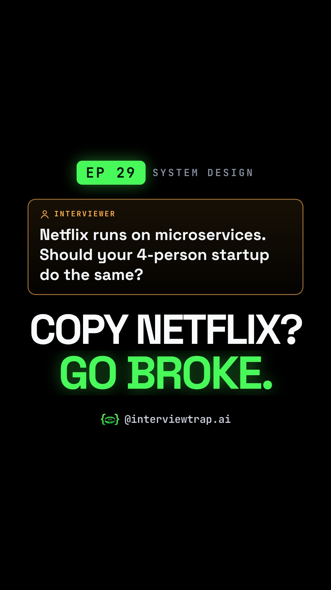

# EP 29 · Should Every Startup Use Microservices? Monolith vs Microservices (System Design Interview)

| | |
|---|---|
| Category | System Design & Scaling |
| Duration | 81.5 s |
| Video | [should-every-startup-use-microservices-absolutel-001.mp4](https://raw.githubusercontent.com/PunithVT/career-ops/main/interview-prep-videos/videos/should-every-startup-use-microservices-absolutel-001.mp4) |
| Cover / thumbnail | [should-every-startup-use-microservices-absolutel-001.jpg](https://raw.githubusercontent.com/PunithVT/career-ops/main/interview-prep-videos/covers/should-every-startup-use-microservices-absolutel-001.jpg) |
| Subtitles | [should-every-startup-use-microservices-absolutel-001.srt](https://raw.githubusercontent.com/PunithVT/career-ops/main/interview-prep-videos/subtitles/should-every-startup-use-microservices-absolutel-001.srt) |



## Instagram caption
```
EP 29 · Should a 4-person startup with 2,000 orders a day build 12 microservices because Netflix does? Absolutely not.

Think of a tailor shop. Measure, cut and stitch under one roof: the cloth passes by hand, like a function call. That's a monolith, and when the rush comes you open copies of the same shop: monoliths scale horizontally too. Microservices mainly solve a team problem: many teams that need to deploy independently. Split every step into its own shop and every handoff becomes a courier ride, a network call that can fail. Payment taken at one shop and cloth lost at another? One transaction now needs a saga. And shops that share one godown (a shared database) and deploy together are a distributed monolith: all the cost, none of the independence.

The twist: at 60 engineers with colliding deploys, build a modular monolith first, then move out only the module with a real reason, gradually and with its own database, using the strangler fig pattern. Netflix itself migrated gradually over years.

Send this to a friend who has a system design interview coming up.

What would YOU answer in the interview? Comment below 👇

Follow @interviewtrap.ai for daily interview traps.

Animated emoji: Noto Emoji Animation by Google, CC BY 4.0 (creativecommons.org/licenses/by/4.0). Modified (resized/re-timed).

#SystemDesign #Microservices #Monolith #SoftwareArchitecture #TechInterview #BackendDevelopment #InterviewTrapAI
```

## YouTube Shorts
**Title:** EP 29 · Should Every Startup Use Microservices? Monolith vs Microservices #Shorts

**Description:**
```
EP 29 · Should a 4-person startup with 2,000 orders a day build 12 microservices because Netflix does? Absolutely not.

Think of a tailor shop. Measure, cut and stitch under one roof: the cloth passes by hand, like a function call. That's a monolith, and when the rush comes you open copies of the same shop: monoliths scale horizontally too. Microservices mainly solve a team problem: many teams that need to deploy independently. Split every step into its own shop and every handoff becomes a courier ride, a network call that can fail. Payment taken at one shop and cloth lost at another? One transaction now needs a saga. And shops that share one godown (a shared database) and deploy together are a distributed monolith: all the cost, none of the independence.

The twist: at 60 engineers with colliding deploys, build a modular monolith first, then move out only the module with a real reason, gradually and with its own database, using the strangler fig pattern. Netflix itself migrated gradually over years.

Send this to a friend who has a system design interview coming up.

What would YOU answer in the interview? Comment below 👇

Follow @interviewtrap.ai for daily interview traps.

Animated emoji: Noto Emoji Animation by Google, CC BY 4.0 (creativecommons.org/licenses/by/4.0). Modified (resized/re-timed).

#SystemDesign #Microservices #Monolith #SoftwareArchitecture #TechInterview #BackendDevelopment #InterviewTrapAI #Shorts
```
**Tags:** SystemDesign, Microservices, Monolith, SoftwareArchitecture, TechInterview, BackendDevelopment, InterviewTrapAI, interview preparation, tech interview, Shorts
**Category:** Education · **AI voice disclosed:** yes · **Made for kids:** no

## Cover text
COPY NETFLIX? GO BROKE.
