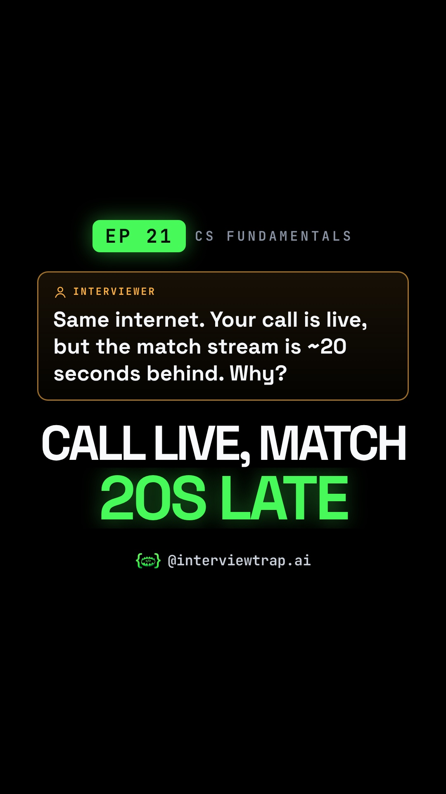

# EP 21 · TCP vs UDP Explained: Why Your Call Is Live but the Match Is 20 Seconds Late (Interview Question)

| | |
|---|---|
| Category | CS Fundamentals |
| Duration | 85.2 s |
| Video | [tcp-vs-udp-why-your-call-is-live-but-the-match-i-001.mp4](https://raw.githubusercontent.com/PunithVT/career-ops/main/interview-prep-videos/videos/tcp-vs-udp-why-your-call-is-live-but-the-match-i-001.mp4) |
| Cover / thumbnail | [tcp-vs-udp-why-your-call-is-live-but-the-match-i-001.jpg](https://raw.githubusercontent.com/PunithVT/career-ops/main/interview-prep-videos/covers/tcp-vs-udp-why-your-call-is-live-but-the-match-i-001.jpg) |
| Subtitles | [tcp-vs-udp-why-your-call-is-live-but-the-match-i-001.srt](https://raw.githubusercontent.com/PunithVT/career-ops/main/interview-prep-videos/subtitles/tcp-vs-udp-why-your-call-is-live-but-the-match-i-001.srt) |



## Instagram caption
```
EP 21 · Your call is live. The match on your phone is ~20 seconds behind. Same internet. Why?

'Video means UDP' is the answer that gets candidates rejected. Think of a coaching class: Sir dictates, word 4 gets lost. The TCP student won't write 5, 6, 7 until 4 is repeated (head-of-line blocking). On UDP the app decides: ask again, add redundancy, or skip. A call needs well under a second, so it uses RTP over UDP.

Big streams come from CDNs in 6-second chunks and the player buffers about three of them, so a TCP retransmit hides inside that buffer. The delay is mostly buffering, not TCP. Twist: HTTP/3 runs on QUIC, which runs on UDP.

Send this to a friend who has a networking or system design interview coming up.

What would YOU answer in the interview? Comment below 👇

Follow @interviewtrap.ai for daily interview traps.

Animated emoji: Noto Emoji Animation by Google, CC BY 4.0 (creativecommons.org/licenses/by/4.0). Modified (resized/re-timed).

#TCPvsUDP #ComputerNetworks #TechInterview #PlacementPrep #SystemDesign #HTTP3 #InterviewTrapAI
```

## YouTube Shorts
**Title:** EP 21 · TCP vs UDP Explained: Why Your Call Is Live but the Match Is 20 Seconds Late #Shorts

**Description:**
```
EP 21 · Your call is live. The match on your phone is ~20 seconds behind. Same internet. Why?

'Video means UDP' is the answer that gets candidates rejected. Think of a coaching class: Sir dictates, word 4 gets lost. The TCP student won't write 5, 6, 7 until 4 is repeated (head-of-line blocking). On UDP the app decides: ask again, add redundancy, or skip. A call needs well under a second, so it uses RTP over UDP.

Big streams come from CDNs in 6-second chunks and the player buffers about three of them, so a TCP retransmit hides inside that buffer. The delay is mostly buffering, not TCP. Twist: HTTP/3 runs on QUIC, which runs on UDP.

Send this to a friend who has a networking or system design interview coming up.

What would YOU answer in the interview? Comment below 👇

Follow @interviewtrap.ai for daily interview traps.

Animated emoji: Noto Emoji Animation by Google, CC BY 4.0 (creativecommons.org/licenses/by/4.0). Modified (resized/re-timed).

#TCPvsUDP #ComputerNetworks #TechInterview #PlacementPrep #SystemDesign #HTTP3 #InterviewTrapAI #Shorts
```
**Tags:** TCPvsUDP, ComputerNetworks, TechInterview, PlacementPrep, SystemDesign, HTTP3, InterviewTrapAI, interview preparation, tech interview, Shorts
**Category:** Education · **AI voice disclosed:** yes · **Made for kids:** no

## Cover text
CALL LIVE, MATCH 20s LATE
