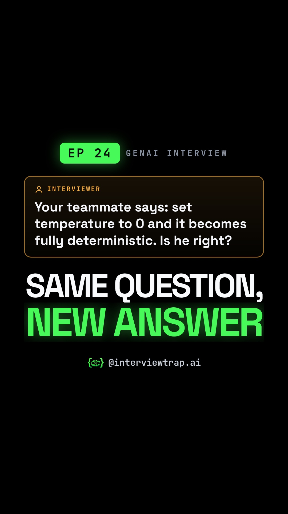

# EP 24 · LLM Temperature Explained: Why Temperature 0 Still Isn't Deterministic (7/10 Then 8/10, GenAI Interview Question)

| | |
|---|---|
| Category | Generative AI |
| Duration | 83.4 s |
| Video | [temperature-same-question-two-different-answers-001.mp4](https://raw.githubusercontent.com/PunithVT/career-ops/main/interview-prep-videos/videos/temperature-same-question-two-different-answers-001.mp4) |
| Cover / thumbnail | [temperature-same-question-two-different-answers-001.jpg](https://raw.githubusercontent.com/PunithVT/career-ops/main/interview-prep-videos/covers/temperature-same-question-two-different-answers-001.jpg) |
| Subtitles | [temperature-same-question-two-different-answers-001.srt](https://raw.githubusercontent.com/PunithVT/career-ops/main/interview-prep-videos/subtitles/temperature-same-question-two-different-answers-001.srt) |



## Instagram caption
```
EP 24 · Same answer, same AI grader: 7/10, then 8/10 on a re-run. Your teammate says 'set temperature to 0'. Is he right?

Temperature reshapes the model's probabilities; it adds no knowledge. Picture a shared auto at every turn: main road 65%, shortcut lane 26%, flyover 9%. Low temperature is a careful driver, high temperature is weighted dice, and T = 0 is argmax: always the top option. One different early turn changes the whole route, and one different early token changes the whole answer.

The trap: even at T = 0 output isn't guaranteed identical. Server load changes the batch size, the GPU math shifts slightly, and near-tied tokens can flip. Other users' prompts never leak into yours. For fair grading, store the first score, use a strict rubric with a JSON score per criterion, and send disagreements to a human.

Send this to a friend who has a GenAI interview coming up.

What would YOU answer in the interview? Comment below 👇

Follow @interviewtrap.ai for daily interview traps.

Animated emoji: Noto Emoji Animation by Google, CC BY 4.0 (creativecommons.org/licenses/by/4.0). Modified (resized/re-timed).

#GenerativeAI #LLM #AIInterview #MachineLearning #TechInterview #PromptEngineering #InterviewTrapAI
```

## YouTube Shorts
**Title:** EP 24 · LLM Temperature Explained: Why Temperature 0 Still Isn't Deterministic #Shorts

**Description:**
```
EP 24 · Same answer, same AI grader: 7/10, then 8/10 on a re-run. Your teammate says 'set temperature to 0'. Is he right?

Temperature reshapes the model's probabilities; it adds no knowledge. Picture a shared auto at every turn: main road 65%, shortcut lane 26%, flyover 9%. Low temperature is a careful driver, high temperature is weighted dice, and T = 0 is argmax: always the top option. One different early turn changes the whole route, and one different early token changes the whole answer.

The trap: even at T = 0 output isn't guaranteed identical. Server load changes the batch size, the GPU math shifts slightly, and near-tied tokens can flip. Other users' prompts never leak into yours. For fair grading, store the first score, use a strict rubric with a JSON score per criterion, and send disagreements to a human.

Send this to a friend who has a GenAI interview coming up.

What would YOU answer in the interview? Comment below 👇

Follow @interviewtrap.ai for daily interview traps.

Animated emoji: Noto Emoji Animation by Google, CC BY 4.0 (creativecommons.org/licenses/by/4.0). Modified (resized/re-timed).

#GenerativeAI #LLM #AIInterview #MachineLearning #TechInterview #PromptEngineering #InterviewTrapAI #Shorts
```
**Tags:** GenerativeAI, LLM, AIInterview, MachineLearning, TechInterview, PromptEngineering, InterviewTrapAI, interview preparation, tech interview, Shorts
**Category:** Education · **AI voice disclosed:** yes · **Made for kids:** no

## Cover text
SAME QUESTION, NEW ANSWER
