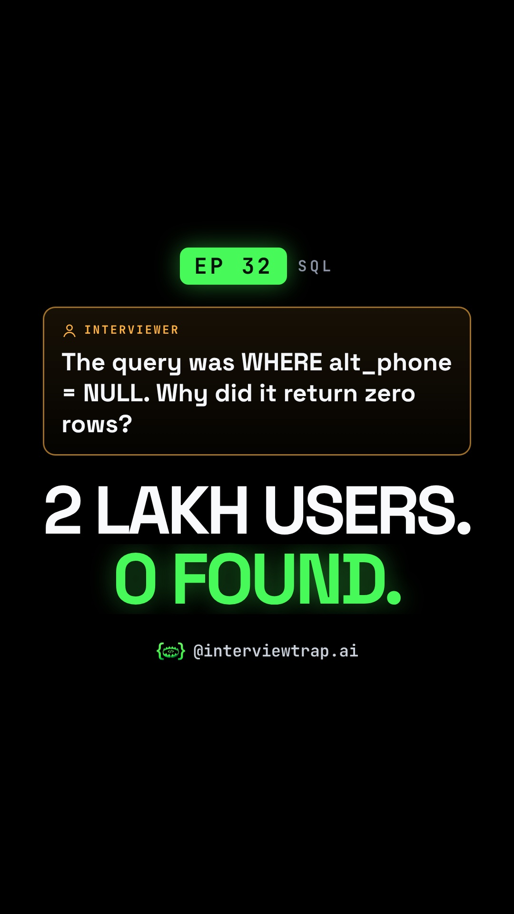

# EP 32 · WHERE phone = NULL Returned Zero Rows: SQL NULL and Three-Valued Logic (SQL Interview Question)

| | |
|---|---|
| Category | Databases & SQL |
| Duration | 84.6 s |
| Video | [where-phone-null-the-query-that-returned-zero-ro-001.mp4](https://raw.githubusercontent.com/PunithVT/career-ops/main/interview-prep-videos/videos/where-phone-null-the-query-that-returned-zero-ro-001.mp4) |
| Cover / thumbnail | [where-phone-null-the-query-that-returned-zero-ro-001.jpg](https://raw.githubusercontent.com/PunithVT/career-ops/main/interview-prep-videos/covers/where-phone-null-the-query-that-returned-zero-ro-001.jpg) |
| Subtitles | [where-phone-null-the-query-that-returned-zero-ro-001.srt](https://raw.githubusercontent.com/PunithVT/career-ops/main/interview-prep-videos/subtitles/where-phone-null-the-query-that-returned-zero-ro-001.srt) |



## Instagram caption
```
EP 32 · 2 lakh users have no alternate phone. WHERE alt_phone = NULL says: zero.

In SQL, NULL means unknown, not empty. Any ordinary comparison with NULL (=, <>, <, >) gives UNKNOWN, and WHERE keeps only TRUE rows, so = NULL never matches. Use IS NULL. The same logic quietly drops NULL cities from WHERE city <> 'Mumbai', so add OR city IS NULL (or a null-safe IS DISTINCT FROM).

The twist: NOT IN with a NULL in the subquery returns zero rows. Use NOT EXISTS or a LEFT JOIN anti-join.

Send this to a friend who has an SQL interview coming up.

What would YOU answer in the interview? Comment below 👇

Follow @interviewtrap.ai for daily interview traps.

Animated emoji: Noto Emoji Animation by Google, CC BY 4.0 (creativecommons.org/licenses/by/4.0). Modified (resized/re-timed).

#SQL #SQLInterview #Database #PostgreSQL #BackendDevelopment #TechInterview #PlacementPrep #InterviewTrapAI
```

## YouTube Shorts
**Title:** EP 32 · WHERE phone = NULL Returned Zero Rows: SQL NULL and Three-Valued Logic #Shorts

**Description:**
```
EP 32 · 2 lakh users have no alternate phone. WHERE alt_phone = NULL says: zero.

In SQL, NULL means unknown, not empty. Any ordinary comparison with NULL (=, ‹›, ‹, ›) gives UNKNOWN, and WHERE keeps only TRUE rows, so = NULL never matches. Use IS NULL. The same logic quietly drops NULL cities from WHERE city ‹› 'Mumbai', so add OR city IS NULL (or a null-safe IS DISTINCT FROM).

The twist: NOT IN with a NULL in the subquery returns zero rows. Use NOT EXISTS or a LEFT JOIN anti-join.

Send this to a friend who has an SQL interview coming up.

What would YOU answer in the interview? Comment below 👇

Follow @interviewtrap.ai for daily interview traps.

Animated emoji: Noto Emoji Animation by Google, CC BY 4.0 (creativecommons.org/licenses/by/4.0). Modified (resized/re-timed).

#SQL #SQLInterview #Database #PostgreSQL #BackendDevelopment #TechInterview #PlacementPrep #InterviewTrapAI #Shorts
```
**Tags:** SQL, SQLInterview, Database, PostgreSQL, BackendDevelopment, TechInterview, PlacementPrep, InterviewTrapAI, interview preparation, tech interview, Shorts
**Category:** Education · **AI voice disclosed:** yes · **Made for kids:** no

## Cover text
2 LAKH USERS. 0 FOUND.
