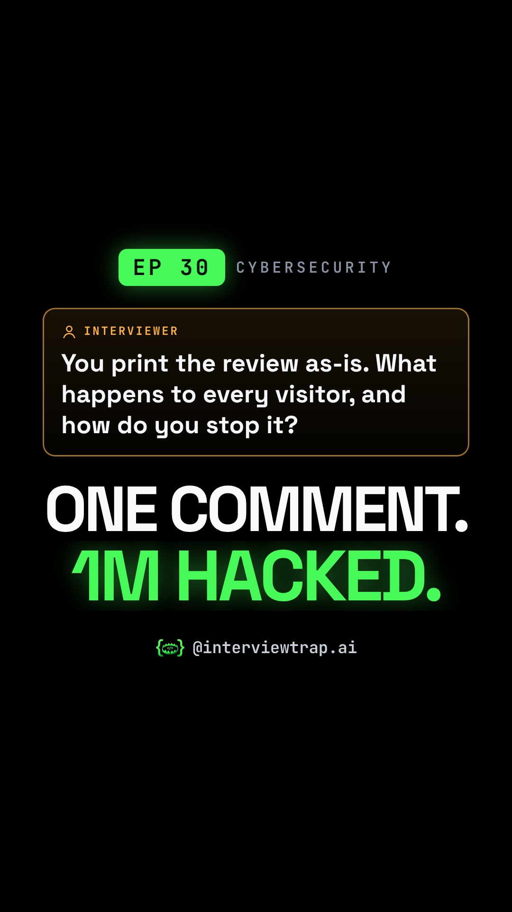

# EP 30 · XSS Explained: The Comment That Ran Code on a Million Profiles (Security Interview Question)

| | |
|---|---|
| Category | Cybersecurity |
| Duration | 84.5 s |
| Video | [xss-the-comment-that-hijacked-a-million-profiles-001.mp4](https://raw.githubusercontent.com/PunithVT/career-ops/main/interview-prep-videos/videos/xss-the-comment-that-hijacked-a-million-profiles-001.mp4) |
| Cover / thumbnail | [xss-the-comment-that-hijacked-a-million-profiles-001.jpg](https://raw.githubusercontent.com/PunithVT/career-ops/main/interview-prep-videos/covers/xss-the-comment-that-hijacked-a-million-profiles-001.jpg) |
| Subtitles | [xss-the-comment-that-hijacked-a-million-profiles-001.srt](https://raw.githubusercontent.com/PunithVT/career-ops/main/interview-prep-videos/subtitles/xss-the-comment-that-hijacked-a-million-profiles-001.srt) |



## Instagram caption
```
EP 30 · One review. 2 lakh visitors a day. Every one of them runs the attacker's script.

That's stored XSS: a review saved as-is and printed raw into the page. The browser trusts it like your own code, inside your origin, so readable cookies leave and the script can act as the user. A firewall is only an extra layer, and stripping <script> fails because  needs no script tag. In 2005 the Samy worm used stored XSS to reach over a million MySpace users in about 20 hours.

The fix: encode output for its context, sanitize rich text with an allowlist sanitizer like DOMPurify, and keep HttpOnly cookies plus a CSP as backup. React escapes JSX text, but dangerouslySetInnerHTML and user-controlled links reopen the hole.

Send this to a friend who has a frontend or security interview coming up.

What would YOU answer in the interview? Comment below 👇

Follow @interviewtrap.ai for daily interview traps.

Animated emoji: Noto Emoji Animation by Google, CC BY 4.0 (creativecommons.org/licenses/by/4.0). Modified (resized/re-timed).

#XSS #WebSecurity #Cybersecurity #OWASP #ReactJS #TechInterview #PlacementPrep #InterviewTrapAI
```

## YouTube Shorts
**Title:** EP 30 · XSS Explained: The Comment That Ran Code on a Million Profiles #Shorts

**Description:**
```
EP 30 · One review. 2 lakh visitors a day. Every one of them runs the attacker's script.

That's stored XSS: a review saved as-is and printed raw into the page. The browser trusts it like your own code, inside your origin, so readable cookies leave and the script can act as the user. A firewall is only an extra layer, and stripping ‹script› fails because ‹img onerror› needs no script tag. In 2005 the Samy worm used stored XSS to reach over a million MySpace users in about 20 hours.

The fix: encode output for its context, sanitize rich text with an allowlist sanitizer like DOMPurify, and keep HttpOnly cookies plus a CSP as backup. React escapes JSX text, but dangerouslySetInnerHTML and user-controlled links reopen the hole.

Send this to a friend who has a frontend or security interview coming up.

What would YOU answer in the interview? Comment below 👇

Follow @interviewtrap.ai for daily interview traps.

Animated emoji: Noto Emoji Animation by Google, CC BY 4.0 (creativecommons.org/licenses/by/4.0). Modified (resized/re-timed).

#XSS #WebSecurity #Cybersecurity #OWASP #ReactJS #TechInterview #PlacementPrep #InterviewTrapAI #Shorts
```
**Tags:** XSS, WebSecurity, Cybersecurity, OWASP, ReactJS, TechInterview, PlacementPrep, InterviewTrapAI, interview preparation, tech interview, Shorts
**Category:** Education · **AI voice disclosed:** yes · **Made for kids:** no

## Cover text
ONE COMMENT. 1M HACKED.
